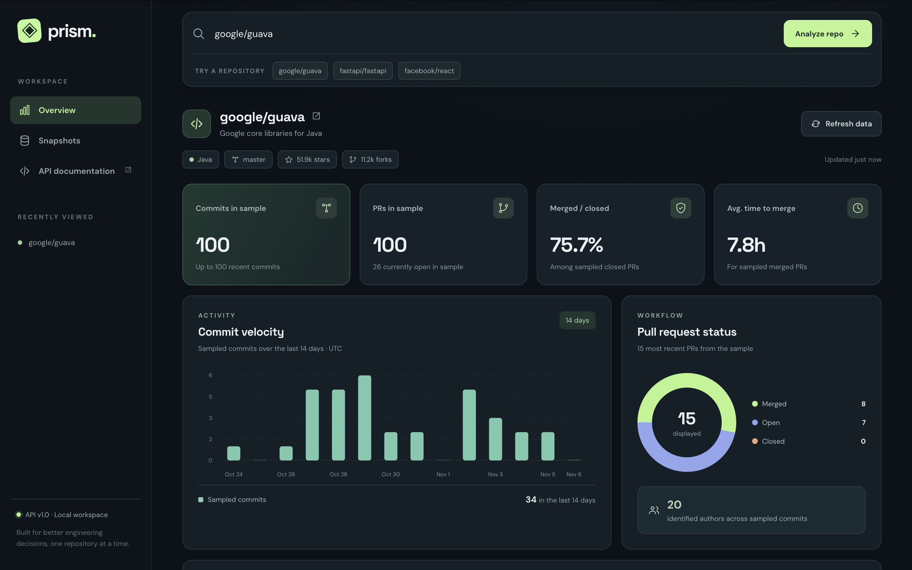
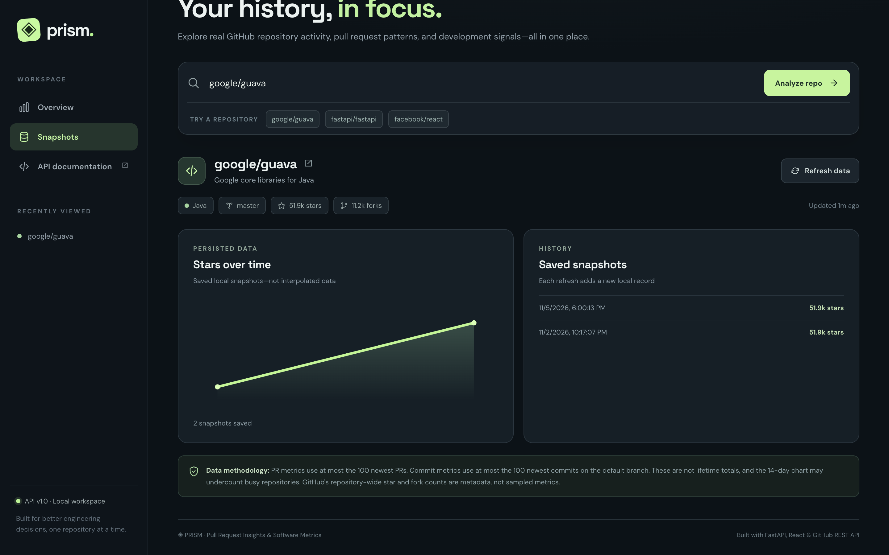

# PRISM
### Pull Request Insights & Software Metrics

A full-stack developer analytics platform for exploring GitHub repository activity, pull request workflows, and engineering metrics.

PRISM transforms GitHub API data into an interactive dashboard, making it easier to understand repository activity and development patterns.

## Dashboard Preview



### Snapshot History



## Features

- **Repository Analytics:** Explore public GitHub repositories.
- **Commit Activity:** Visualize sampled commit activity over 14 days.
- **Pull Request Insights:** Analyze open, closed, and merged pull requests.
- **Merge Metrics:** Calculate sampled merge rates and average merge times.
- **Snapshot History:** Store repository analytics using SQLite.
- **Caching:** Reuse recent analytics results to reduce API requests.
- **Error Handling:** Handle invalid repositories, rate limits, and network failures.
- **Automated Testing:** Verify application behavior with pytest.
- **CI:** Run backend tests and frontend builds through GitHub Actions.

## Tech Stack

| Category | Technologies |
|----------|-------------|
| Backend | Python, FastAPI, HTTPX |
| Frontend | React, TypeScript, Vite |
| Database | SQLite |
| API | GitHub REST API |
| Testing | pytest, FastAPI TestClient |
| DevOps | Docker, GitHub Actions |

## Architecture

```text
React + TypeScript Dashboard
           |
           v
      FastAPI Backend
           |
    +------+------+
    |             |
    v             v
 GitHub API    SQLite
    |
    v
Analytics Processing
    |
    v
Dashboard Response
```

The backend is organized into separate modules:

- `main.py` handles application routes and responses.
- `github_client.py` communicates with GitHub.
- `analytics.py` processes repository data.
- `storage.py` manages SQLite snapshots and caching.

## Getting Started

### Prerequisites

- Python 3.13+
- Node.js and npm
- Git
- Docker (optional)

### Option 1: Docker

Build the application:

```bash
docker build -t prism .
```

Run PRISM:

```bash
docker run --rm -p 8080:8080 prism
```

Open http://localhost:8080.

### Option 2: Local Development

Clone the repository:

```bash
git clone https://github.com/Jaydenzga/prism-dev-analytics.git
cd prism-dev-analytics
```

Create a Python environment:

```bash
python3 -m venv .venv
source .venv/bin/activate
pip install -r requirements.txt
```

Start the backend:

```bash
python -m uvicorn app.main:app --reload
```

In a second terminal, start React:

```bash
cd web
npm ci
npm run dev
```

Open http://localhost:5173.

## Testing

Run backend tests:

```bash
python -m pytest -v
```

Build the frontend:

```bash
cd web
npm run build
```

The project includes 13 passing backend tests and a GitHub Actions workflow for continuous integration.

## Limitations

- GitHub activity metrics use recent API samples, not complete repository histories.
- Unauthenticated GitHub API requests are subject to rate limits.
- SQLite snapshot storage is local. Data inside an unmounted Docker container is not persistent after that container is removed.
- PRISM is currently available through local development or Docker, not a public hosted instance.

## Future Improvements

- Side-by-side repository comparisons
- Pull request filtering and sorting
- Expanded historical analytics
- Additional automated tests
- Optional persistent cloud storage

## Project Status

Functional MVP — Backend, frontend, analytics, local storage, testing, CI, and Docker setup implemented.
